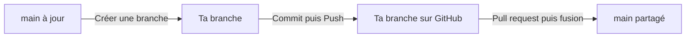

# Mini-projet R1.02

Site d’équipe en HTML et CSS. Pour le voir sur ton PC, ouvre `index.html` dans ton navigateur après avoir cloné le dépôt.

## Travailler avec VS Code sur Windows

**La première fois** · Accepte l’invitation GitHub. Dans VS Code, fais **Ctrl + Maj + P → Git: Clone**, colle l’adresse ci-dessous et ouvre le dossier cloné. Connecte-toi avec le compte invité si GitHub te le demande.

```text
https://github.com/ArthurPhisbien/mini_Projet_R1.02.git
```

**Pour chaque tâche**



| Tu veux… | Où cliquer |
| --- | --- |
| 📥 **Récupérer le travail de l’équipe** | En bas à gauche, passe sur `main`. Puis **Ctrl + Maj + G → … → Pull**. |
| 🌿 **Coder sur ta branche** | Depuis `main` à jour, clique sur son nom en bas à gauche → **Créer une branche**. Exemple : `lea/page-contact`. |
| 📤 **Envoyer ton travail** | **Ctrl + Maj + G → +** sur les fichiers voulus → écris un message → **Commit**. Puis **Publier la branche** au premier envoi, ou **… → Push** ensuite. |
| 🤝 **Proposer ta partie à l’équipe** | Sur GitHub → **Pull requests → New pull request**. Choisis ta branche dans **compare** et `main` dans **base**. |

> **Commit** enregistre une version sur ton PC. **Push** l’envoie sur GitHub. **Pull** récupère les changements de la branche sur laquelle tu es.

<details>
<summary>Voir les commandes équivalentes dans le terminal</summary>

### Première fois

Accepte l’invitation GitHub, puis lance ces commandes depuis le dossier où tu veux placer le projet.

```bash
git clone https://github.com/ArthurPhisbien/mini_Projet_R1.02.git
cd mini_Projet_R1.02
```

### Pour chaque nouvelle tâche

Pars de la version commune à jour et crée une branche avec un nom unique. Remplace `prenom/page-equipe` par ton prénom et ta tâche.

```bash
git switch main
git pull --ff-only
git switch -c prenom/page-equipe
```

Répartissez-vous les pages ou sections. Par exemple, une personne peut travailler sur `equipe.html` et `css/equipe.css`, une autre sur `contact.html` et `css/contact.css`. Coordonnez les changements dans `index.html` et `css/style.css`, qui servent de base commune.

### Envoyer ton travail

Après tes modifications, vérifie les fichiers concernés et fais ton premier push.

```bash
git status
git add equipe.html css/equipe.css
git commit -m "Ajouter la page équipe"
git push -u origin prenom/page-equipe
```

Adapte les chemins à tes fichiers. Pour les prochains envois sur cette branche, fais un commit puis `git push`. Tu peux envoyer tes commits au fur et à mesure.

Pour intégrer ton travail, ouvre une **pull request** sur GitHub depuis ta branche vers `main`. Après la fusion, le prochain `git pull --ff-only` sur `main` récupère la version commune.

### Récupérer les changements pendant une tâche

Enregistre d’abord tes modifications dans un commit. Depuis ta branche de travail, récupère puis intègre les changements déjà fusionnés dans `main`.

```bash
git fetch origin
git merge origin/main
```

Si Git signale un conflit, ouvre les fichiers signalés, garde les lignes voulues, puis ajoute les fichiers corrigés avec `git add` et termine avec `git commit`.

</details>
